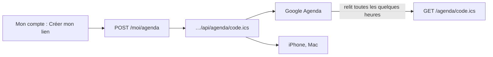

# Dans mon agenda

Les dates de Cadeaux dans l'agenda de l'utilisateur, par abonnement (format iCalendar), sans rien installer.

## Ce que contient l'agenda
- **Anniversaires** des proches, qui reviennent chaque année (`RRULE:FREQ=YEARLY`) : date de la fiche, sinon celle du compte associé.
- **Occasions** (Noël, fête des mères…), sauf celles de type « anniversaire » (déjà là chaque année).
- **Fin des cagnottes** encore ouvertes qui ont une date limite.
Chaque date est un événement « journée entière », transparent (n'occupe pas l'agenda), avec le lien vers la page dans Cadeaux.

## Lien
- `POST /moi/agenda` : nouveau lien `https://cadeaux.bsandoz.fr/api/agenda/<code>.ics` (code de 256 bits, empreinte gardée dans `comptes.agenda_empreinte`) ; l'ancien cesse de marcher. Affiché une seule fois.
- `DELETE /moi/agenda` : coupe le lien.
- `GET /agenda/<code>.ics` : l'agenda (texte iCalendar, lignes pliées à 75 octets, textes échappés), relu par les agendas toutes les quelques heures (`REFRESH-INTERVAL` 12 h).
- `GET /moi` : `agenda` vrai si un lien est actif.

## Écran (Mon compte)
« Créer mon lien d'agenda », puis « Ajouter à Google Agenda » (`calendar.google.com/calendar/r?cid=webcal://…`), « Ajouter à l'iPhone ou au Mac » (`webcal://…`), ou copier le lien (Outlook…). Ensuite : « Nouveau lien » et « Couper le lien ».

## Tests
- `api/tests/AgendaTest.php` : contenu (anniversaire chaque année, virgule échappée, occasion, cagnotte, pas de doublon, lignes de 75 octets au plus), nouveau lien qui remplace l'ancien, couper, un agenda ne montre que son compte.
- `front/src/App.test.tsx` : création du lien et boutons Google Agenda, iPhone, copie.
