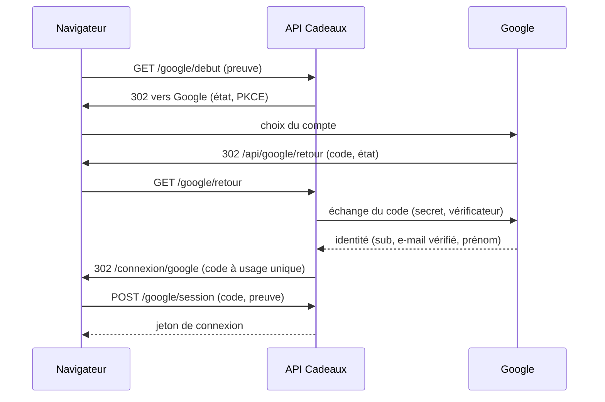

# Connexion avec Google

« Continuer avec Google » sur l'écran d'accueil (création de compte et connexion), sur une invitation à associer son compte (`/rejoindre/…`) et sur « On se cotise » d'une liste d'envies : on revient sur la page après la connexion.

## Principe
OAuth 2.0 avec code d'autorisation, **PKCE** et **état**, fait par le serveur : **aucun script de Google** sur le site (la CSP reste `script-src 'self'`, pas de cookie ni de traceur).

1. Le bouton tire au hasard une **preuve** (64 caractères), la garde dans l'onglet (`sessionStorage`) et ouvre `/api/google/debut?preuve=…&retour=…`.
2. L'API enregistre (table `google_etats`, 10 minutes) l'empreinte de l'état, l'empreinte de la preuve, le vérificateur PKCE et la page de retour (liste d'envies, cagnotte ou invitation seulement), puis redirige vers Google.
3. Google renvoie sur `/api/google/retour?code=…&state=…`. L'API échange le code (avec le secret et le vérificateur) contre le jeton d'identité, reçu directement de Google en HTTPS, et contrôle : destinataire (`aud`), émetteur, expiration, adresse vérifiée.
4. Compte : déjà relié (`comptes.google_sub`), sinon celui de la même adresse (relié et confirmé), sinon créé (adresse confirmée, rappels non cochés, mot de passe inconnu : « Mot de passe oublié ? » permet d'en choisir un). Un compte bloqué ne se connecte pas.
5. L'API renvoie sur `/connexion/google?code=…` avec un code à usage unique (table `liens`, type `google`, 2 minutes). L'écran l'envoie à `POST /google/session` avec la preuve de l'onglet : un lien de retour volé ne connecte pas un autre navigateur.
6. La session s'ouvre comme une connexion normale (jeton, e-mail « Nouvelle connexion » sur un nouvel appareil, sauf compte tout juste créé), puis retour à la page de départ.

## Réglages
`config.local.php` : `'google' => ['id' => …, 'secret' => …]`, écrit au déploiement depuis les secrets `GOOGLE_CLIENT_ID` et `GOOGLE_CLIENT_SECRET`. Sans eux, `GET /google` répond `actif: false` et le bouton est caché. Création du client : `docs/mise-en-ligne.md`.

## Fichiers
- API : `src/ConnexionGoogle.php`, `src/Google.php`, `src/GoogleHttp.php`, routes dans `src/Application.php`, schéma v15 (`comptes.google_sub`, `google_etats`), ménage des départs expirés.
- Site : `components/BoutonGoogle.tsx`, `pages/ConnexionGoogle.tsx`, route `/connexion/google`.

## Tests
- `api/tests/GoogleTest.php` (faux Google) : départ (PKCE, état, empreintes), création, compte existant relié sans doublon, retour par identifiant Google, page de retour sûre, lien volé refusé, code unique et expirant, état inconnu ou expiré, annulation, identités refusées (destinataire, émetteur, expiration, adresse non vérifiée), compte bloqué.
- `front/src/App.test.tsx` : bouton seulement si actif, départ avec preuve, retour qui ouvre la session, refus sans preuve, message d'annulation.
