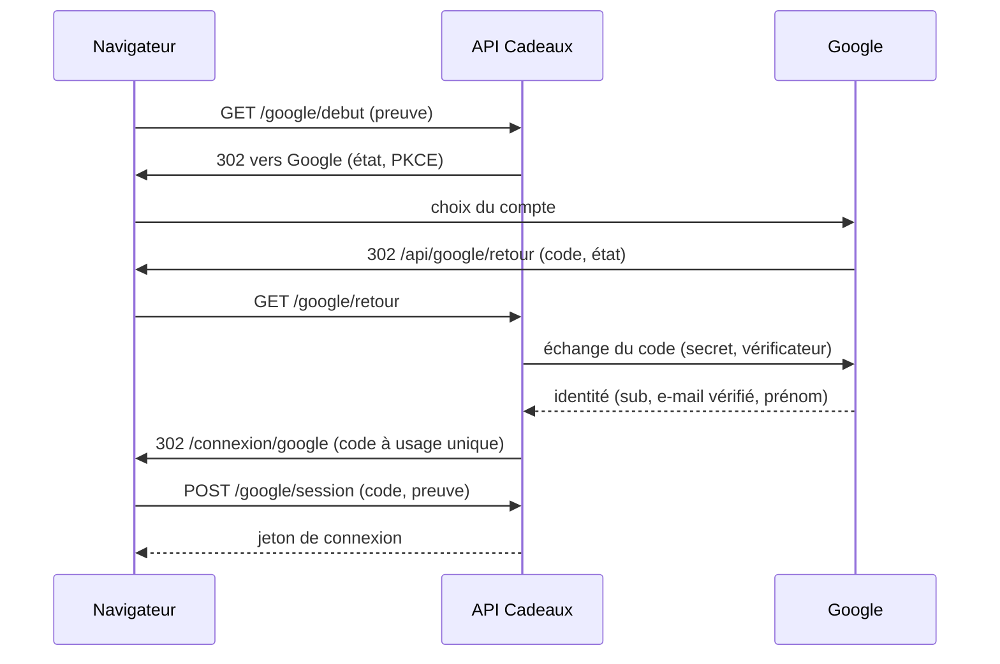

# Connexion avec Google

« Continuer avec Google » sur l'écran d'accueil (création de compte et connexion), sur une invitation à associer son compte (`/rejoindre/…`) et sur « On se cotise » d'une liste d'envies : on revient sur la page après la connexion.

## Principe
OAuth 2.0 avec code d'autorisation, **PKCE** et **état**, fait par le serveur : **aucun script de Google** sur le site (la CSP reste `script-src 'self'`, pas de cookie ni de traceur).

1. Le bouton tire au hasard une **preuve** (64 caractères), la garde dans l'onglet (`sessionStorage`) et ouvre `/api/google/debut?preuve=…&retour=…`.
2. L'API enregistre (table `google_etats`, 10 minutes) l'empreinte de l'état, l'empreinte de la preuve, le vérificateur PKCE et la page de retour (liste d'envies, cagnotte ou invitation seulement), puis redirige vers Google.
3. Google renvoie sur `/api/google/retour?code=…&state=…`. L'API échange le code (avec le secret et le vérificateur) contre le jeton d'identité, reçu directement de Google en HTTPS, et contrôle : destinataire (`aud`), émetteur, expiration, adresse vérifiée.
4. Compte : déjà relié (`comptes.google_sub`), sinon celui de la même adresse (relié et confirmé), sinon créé (adresse confirmée, rappels non cochés, mot de passe inconnu : « Mot de passe oublié ? » permet d'en choisir un). Un compte bloqué ne se connecte pas.
5. L'API renvoie sur `/connexion/google?code=…` avec un code à usage unique (table `liens`, type `google`, 2 minutes). L'écran l'envoie à `POST /google/session` avec la preuve de l'onglet : un lien de retour volé ne connecte pas un autre navigateur.
6. La session s'ouvre comme une connexion normale (jeton, e-mail « Nouvelle connexion » sur un nouvel appareil, sauf compte tout juste créé), puis retour à la page de départ.

## Dans « Mon compte »
- **Relier** (`POST /moi/google/relier`, connecté) : même départ, avec le compte noté dans `google_etats.compte_id`. Au retour, rien n'est créé : lien `googlelier` (2 min) puis `POST /moi/google/relier/fin` depuis le même onglet (preuve) et le même compte. Refusé si ce compte Google est déjà relié à un autre compte (`?google=deja`).
- **Délier** (`POST /moi/google/delier`) : seulement si un mot de passe existe (`comptes.mot_de_passe_defini`), sinon 409.
- **Compte créé avec Google** (`mot_de_passe_defini = 0`) : « Recevoir le lien » envoie le lien de « Mot de passe oublié » à l'adresse du compte ; le mot de passe choisi par ce lien rend `mot_de_passe_defini = 1`. Le changement d'adresse, qui demande le mot de passe, attend ce choix. Comptes reliés avant ce réglage : considérés avec mot de passe.

## Dans l'extension Chrome
La fenêtre de l'extension ne peut pas afficher la page de Google : « Continuer avec Google » ouvre `https://cadeaux.bsandoz.fr/extension`. On s'y connecte (Google ou mot de passe, retour sur `/extension`), puis « Connecter l'extension » demande `POST /moi/extension/code` (code à usage unique, 2 min, `ConnexionExtension.php`). La page le donne par `postMessage` au script de l'extension sur le site (`extension/site.js`), qui le passe au service de fond (`fond.js`, expéditeur vérifié : origine du site) ; celui-ci l'échange par `POST /extension/session` contre la connexion de l'extension. Sans extension détectée, la page propose de l'installer.

## Réglages
`config.local.php` : `'google' => ['id' => …, 'secret' => …]`, écrit au déploiement depuis les secrets `GOOGLE_CLIENT_ID` et `GOOGLE_CLIENT_SECRET`. Sans eux, `GET /google` répond `actif: false` et le bouton est caché. Création du client : `docs/mise-en-ligne.md`.

## Fichiers
- Extension : `site.js` (script sur le site), `fond.js` (`code-site`), bouton dans `popup.html` ; page `pages/ConnecterExtension.tsx` ; API `src/ConnexionExtension.php`, tests `ExtensionTest.php`.
- API : `src/ConnexionGoogle.php`, `src/Google.php`, `src/GoogleHttp.php`, routes dans `src/Application.php`, schéma v15 (`comptes.google_sub`, `google_etats`), ménage des départs expirés.
- Site : `components/BoutonGoogle.tsx`, `pages/ConnexionGoogle.tsx`, route `/connexion/google`.

## Tests
- `api/tests/GoogleTest.php` (faux Google) : départ (PKCE, état, empreintes), création, compte existant relié sans doublon, retour par identifiant Google, page de retour sûre, lien volé refusé, code unique et expirant, état inconnu ou expiré, annulation, identités refusées (destinataire, émetteur, expiration, adresse non vérifiée), compte bloqué.
- `api/tests/GoogleTest.php` aussi : relier un compte d'adresse différente, refus depuis un autre onglet ou un autre compte, compte Google déjà utilisé, délier seulement avec un mot de passe.
- `front/src/App.test.tsx` : relier depuis « Mon compte », compte sans mot de passe (pas de « Délier », lien pour choisir un mot de passe), bouton seulement si actif, départ avec preuve, retour qui ouvre la session, refus sans preuve, message d'annulation.
